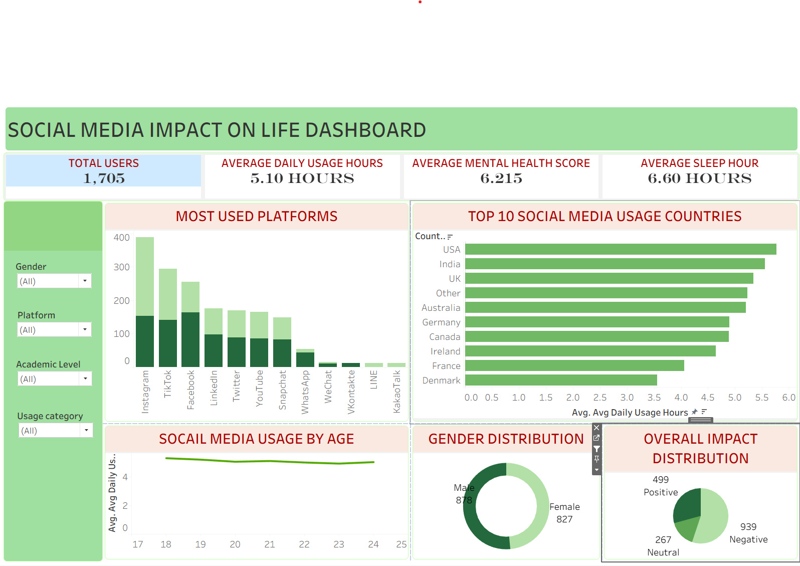

# Social-Media-Impact-Dashboard
# 📊 Social Media Impact Dashboard | Tableau Public

## 📌 Project Overview
This project explores social media usage patterns and their impact on users using an interactive dashboard built with Tableau Public. It presents insights into platform popularity, daily usage hours, sleep duration, demographics, and social media impact categories.

## 🎯 Project Objectives
- Analyze popular social media platforms.
- Compare average daily usage hours across countries.
- Explore usage patterns across different age groups.
- Understand the distribution of users by gender.
- Analyze positive, neutral, and negative social media impacts.
- Examine the relationship between social media usage and sleep duration.

## 🛠️ Tech Stack
- **Tableau Public** – Interactive dashboard and data visualization
- **Exploratory Data Analysis (EDA)** – Identifying patterns and trends
- **Data Visualization** – KPI cards, charts, and interactive filters

## 📈 Key Performance Indicators (KPIs)
- **Total Users:** 1,705
- **Average Daily Usage:** 5.10 hours
- **Average Sleep Duration:** 6.60 hours
- **Average Mental Health Score:** Displayed in the dashboard

## 🔍 Key Insights
- Instagram has the highest user count among the platforms displayed.
- Users spend an average of approximately 5.1 hours per day on social media.
- Average sleep duration is approximately 6.6 hours.
- The dashboard compares social media usage and impact across different demographic groups.
- Interactive filters allow users to explore patterns across platforms, genders, and other categories.

## 🖼️ Dashboard Preview
Add your dashboard screenshot to the repository using the filename `social-media-dashboard.png`.

## 📂 Project Files
- `SOCIAL MEDIA IMPACT.twb` – Tableau workbook
- `tabeau.png` – Dashboard screenshot
- `README.md` – Project documentation

## 💡 Skills Demonstrated
- Data Analysis
- Tableau Dashboard Development
- Data Visualization
- KPI Design
- Exploratory Data Analysis
- Analytical Storytelling

## 👩‍💻 Author
**Data Analytics Portfolio Project**

